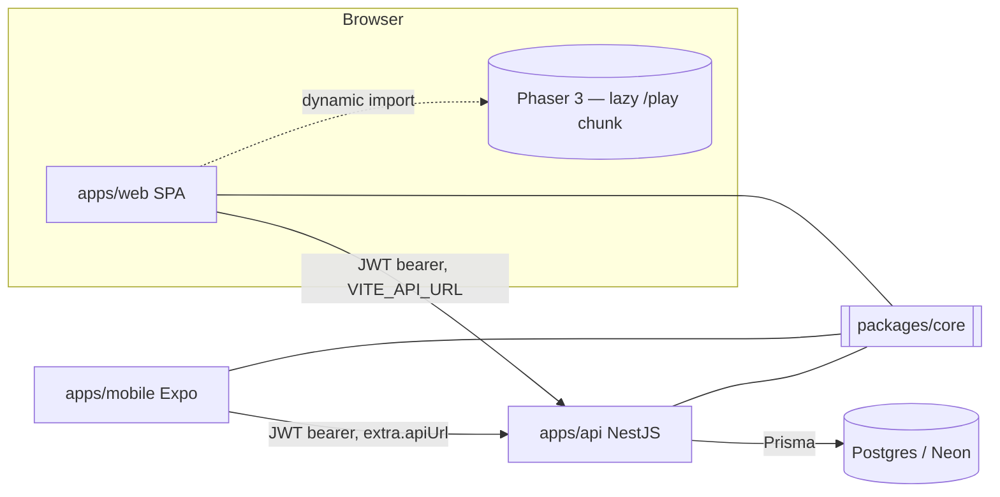
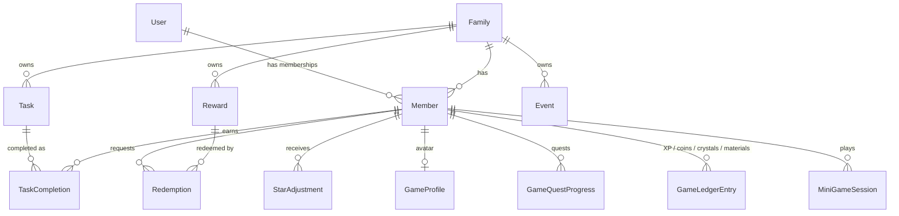
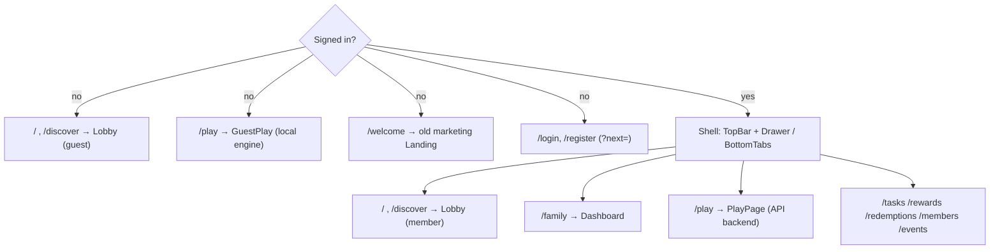

# Existing architecture (audit, 2026-11-24)

Source of truth: the repository at commit `cc85af8` plus the Release 1 changes described in `MIGRATION_PLAN.md`. Everything below is read from code, not assumed.

## Workspace

| Package | Stack | Notes |
| --- | --- | --- |
| `apps/api` | NestJS 10, Prisma, PostgreSQL | Global prefix `/api`, Swagger at `/docs`, global `ValidationPipe({ whitelist, transform })`. Hosted on Render. |
| `apps/web` | Vite, React 18, React Router 6, React Query 5, i18next | Hosted on Vercel (`apps/web/vercel.json`, SPA rewrite to `index.html`). |
| `apps/mobile` | Expo / React Native | Login, Dashboard, Members, Events, Redemptions screens. No game. |
| `packages/core` | TypeScript + Zod | Shared schemas, date/recurrence/star/reward logic, i18n JSON (en, zh, vi), and (new) the world registry. Vitest tests. |

Build: pnpm 9 workspace + Turborepo. Local Postgres via Docker (`pnpm db:up`), production Neon. There is no CI workflow in the repo (`.github/` does not exist); validation is run locally.

## Authentication and family scope

- Email + password (`/auth/register`, `/auth/login`), access + refresh JWT (`/auth/refresh`, `/auth/logout`), password reset by email (`mail` module).
- Web stores tokens in `localStorage` (remember me) or `sessionStorage` (`apps/web/src/lib/api.ts`), and sends `familyId` with every request.
- Every controller uses `JwtAuthGuard` + `resolveFamilyScope` (`apps/api/src/auth/family-scope.ts`); non-members get 403. Parent-only writes call `requireParent`.
- `Member.userId` is nullable: kids are usually login-less profiles managed by a parent. `@@unique([familyId, userId])`.

## Data model (Prisma, `apps/api/prisma/schema.prisma`)

- Stars are never stored: `star-balance/compute.ts` = earned + adjusted − spent (pending redemptions count as spent).
- Game resources are summed from `game_ledger`; `UNIQUE(member_id, source_key)` makes grants idempotent.
- Migrations: `20261009070309_familyhub`, `20261009074040_authresetpassword`, `20261123083323_adventure_game` (additive).

## API surface

`auth`, `families`, `members`, `tasks`, `task-completions`, `rewards`, `redemptions`, `star-balance`, `star-adjustments`, `events`, `game` (`GET state`, `PUT avatar`, quest accept/cancel/claim, daily chest, memory start/finish).

## Web routing (after Release 1)

With `VITE_FLAG_GAME_FIRST_HOME=0` routing returns to the pre-Release-1 shape (`/` = Landing or Dashboard).

## Game runtime (`apps/web/src/game`)

- One `Phaser.Game` per mount (`GameCanvas.tsx`), destroyed on unmount; audio disabled; DPR-aware canvas.
- Scenes: `VillageScene` (arcade physics, A* tap-to-move, NPCs, quests markers, HUD guidance) and `MemoryScene`.
- `bridge.ts` is the typed event channel; React owns data, dialogue, and API calls. Scenes never call the API.
- `GameBackend` interface (`gameApi.ts`) with two adapters: `serverBackend` (API, authoritative) and `guestBackend` (`guest.ts`, localStorage `fh.guest.v1`, mirrors server rules).
- Art is generated on canvas at runtime; no external assets.
