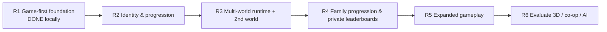

# Migration plan

Incremental releases on the existing app. Each release ships behind flags, keeps existing routes and data, and needs explicit approval before production deploy.

## Release 1 — Game-first platform foundation (implemented, not deployed)

| Item | Implementation |
| --- | --- |
| Lobby replaces landing | `apps/web/src/platform/Lobby.tsx` at `/` and `/discover`, for guests and members. Old landing kept at `/welcome`. |
| Featured world + Continue | Registry `featuredWorld()`; "Continue" when the player has progress or this browser played before (`platform/recent.ts`). |
| Guest play | Unchanged `/play` guest engine; lobby shows guest level/resources from `fh.guest.v1` without creating it. |
| Avatar before play | `/play?open=avatar` opens the existing avatar editor. |
| Contextual auth | `?next=` on `/login` and `/register` (`safeNextPath`). Guest CTAs use `/register?next=/play`. |
| Family dashboard preserved | Dashboard moves from `/` to `/family` (flag on). Members gets a link there because it leaves the phone tab bar. |
| Platform navigation | `components/navItems.ts` shared by Drawer and BottomTabs; guest header + phone tab bar in the lobby. |
| Discovery foundation | `packages/core/src/worlds.ts` (5 worlds; only Family Adventure is `available`). |
| Flags / rollback | `apps/web/src/lib/flags.ts`. |

No API or database changes in Release 1.

### Deploy steps (when approved)
1. Merge; Vercel builds `apps/web` as today. Render needs no redeploy (API unchanged).
2. Smoke test: `/` (guest), `/play`, `/login?next=/family`, signed-in `/`, `/family`, `/members`.
3. Rollback: set `VITE_FLAG_GAME_FIRST_HOME=0` in Vercel and redeploy (old landing + dashboard at `/`).

Behavior change to communicate: signed-in users land on the game lobby; the dashboard is one tap away under **Family**.

## Learning Academy (implemented, not deployed)

- World registry: `learning-academy` is `available` at `/academy` (guest and member).
- Hall (React): Professor Owl instructor with topics, tips, level suggestion, and reactions to the last run; three difficulty boards (Apprentice / Scholar / Master = 6 / 8 / 10 pairs); badges; recent results.
- Boards reuse the village `MemoryScene` in board-only mode (`GameCanvas memory={session}`), lazy-loaded, remounted per session (restart = new server session).
- Server: `finishMemory` now closes the session, grants the daily level reward, and grants badges in one transaction (`createMany … skipDuplicates`). `GET /game/state` adds `achievements` and `memory.recent`, and `memory.levels[].wins`. Additive JSON only; no migration.
- Deploy order: API first (Render, no migration), then web. The web tolerates an older API (missing badges/recent default to empty).
- Guests: same rules from `@family-hub/core` in `guest.ts`. The API cannot import core at runtime (core ships TS source), so it keeps its own copy with a parity test.

## Release 2 — Identity and progression (next)
- `/profile` from existing `Member` + `GameProfile` (no new identity tables).
- Achievements: definitions in core; unlocks written to `game_ledger`-style table with unique keys.
- Per-world progress: add `world_id` to new progress rows (additive migration).
- Guest migration: `POST /game/import-guest` with preview → confirm; server recomputes allowed grants from the guest snapshot, writes them with `guest-import:<key>` source keys in one transaction, marks the local store consumed.
- Add API rate limiting (`@nestjs/throttler`) before any new write endpoints.

## Release 3 — Multi-world runtime
- `WorldRuntime` contract (initialize / start / pause / resume / destroy) wrapping `GameCanvas` and React worlds; one active runtime at a time.
- Learning Academy as a React world reusing the server-validated memory game, plus one new activity.
- `/worlds/:slug` route resolved through the registry.

## Releases 4–6
Family-private leaderboards (cooperative framing, server-validated, no guests), family challenges, parent activity summaries; then inventory/home building; 3D and multiplayer only after safety review.
